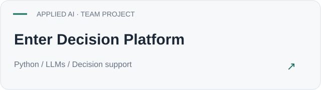
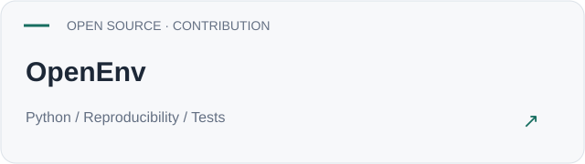
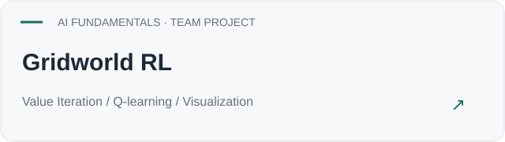
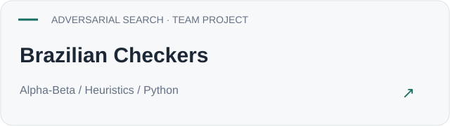
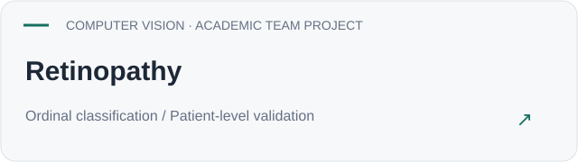
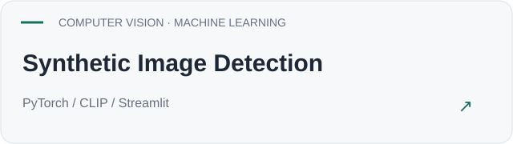
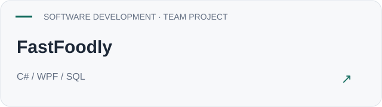
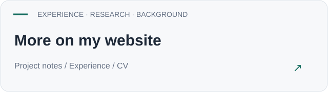

<picture><source media="(prefers-color-scheme: dark)" srcset="assets/header-dark.svg"></picture>

Computer Engineering student at **Unicamp**, graduating in the second half of **2027**. Based in **Campinas**; originally from **Belo Horizonte, Minas Gerais**.

   

## Explore my work

Open a card to visit the project, or expand its notes for context.

<table>
<tr>
<td width="50%" valign="top"><a href="https://github.com/AndreiQP/hackathon-unicamp-2026"><picture><source media="(prefers-color-scheme: dark)" srcset="assets/enter-dark.svg"></picture></a>

<strong>Enter Decision Platform</strong> · notes

My contribution focused on AI Core. The team built a prototype for explained litigation and settlement recommendations and placed first at Enter × Unicamp.

<a href="https://github.com/AndreiQP/hackathon-unicamp-2026">Explore ↗</a>

</td>
<td width="50%" valign="top"><a href="https://github.com/openenv/OpenEnv/pull/1444"><picture><source media="(prefers-color-scheme: dark)" srcset="assets/openenv-dark.svg"></picture></a>

<strong>OpenEnv</strong> · notes

Contributed a merged fix addressing reproducible environment resets, with regression tests. Follow the pull request for the specific scope of this contribution.

<a href="https://github.com/openenv/OpenEnv/pull/1444">Explore ↗</a>

</td>
</tr>
<tr>
<td width="50%" valign="top"><a href="https://github.com/tiagoperrupato/gridworld-rl"><picture><source media="(prefers-color-scheme: dark)" srcset="assets/gridworld-dark.svg"></picture></a>

<strong>Gridworld RL</strong> · notes

A team project comparing planning and learning in a grid environment, with visualizations of policies, learning behavior and trajectories.

<a href="https://github.com/tiagoperrupato/gridworld-rl">Explore ↗</a>

</td>
<td width="50%" valign="top"><a href="https://github.com/tiagoperrupato/mc906-project-brazilian-checkers"><picture><source media="(prefers-color-scheme: dark)" srcset="assets/checkers-dark.svg"></picture></a>

<strong>Brazilian Checkers</strong> · notes

A playable checkers agent with iterative-deepening search, move ordering and heuristic comparisons. The repository includes experiment documentation.

<a href="https://github.com/tiagoperrupato/mc906-project-brazilian-checkers">Explore ↗</a>

</td>
</tr>
<tr>
<td width="50%" valign="top"><a href="https://github.com/AndreiQP/mc906-kaggle-retinopathy"><picture><source media="(prefers-color-scheme: dark)" srcset="assets/retinopathy-dark.svg"></picture></a>

<strong>Retinopathy</strong> · notes

An academic study comparing ML methods for ordinal image classification. Documentation distinguishes completed experiments from available implementations and discusses limitations. This was not a Kaggle competition submission.

<a href="https://github.com/AndreiQP/mc906-kaggle-retinopathy">Explore ↗</a>

</td>
<td width="50%" valign="top"><a href="https://github.com/tiagoperrupato/synthetic-image-detection"><picture><source media="(prefers-color-scheme: dark)" srcset="assets/synthetic-dark.svg"></picture></a>

<strong>Synthetic Image Detection</strong> · notes

Practical model comparison across datasets, with generalization analysis, explainability and an interactive application.

<a href="https://github.com/tiagoperrupato/synthetic-image-detection">Explore ↗</a>

</td>
</tr>
<tr>
<td width="50%" valign="top"><a href="https://github.com/FastFoodly/FastFoodly"><picture><source media="(prefers-color-scheme: dark)" srcset="assets/fastfoodly-dark.svg"></picture></a>

<strong>FastFoodly</strong> · notes

A digital menu and ordering application for restaurants, developed as a course project with a team.

<a href="https://github.com/FastFoodly/FastFoodly">Explore ↗</a>

</td>
<td width="50%" valign="top"><a href="https://tiagoperrupato.github.io/"><picture><source media="(prefers-color-scheme: dark)" srcset="assets/portfolio-dark.svg"></picture></a>

<strong>More on my website</strong> · notes

Visit my website for project notes, professional and research experience, education and the current English CV.

<a href="https://tiagoperrupato.github.io/">Explore ↗</a>

</td>
</tr>
</table>

Team projects link to their original repositories. Contribution notes describe my participation where confirmed.
