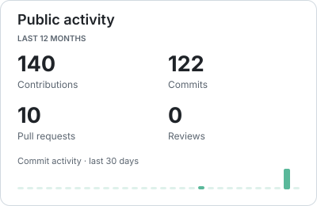
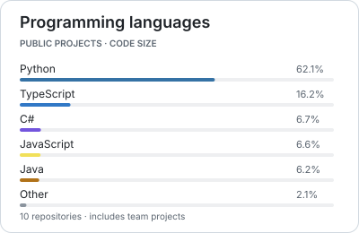

## Tiago Perrupato Antunes

Computer Engineering student at **Unicamp**, interested in applied AI, machine learning and software development.

- 🎓 Expected graduation: **second half of 2027**
- 📍 Living in **Campinas**, originally from **Belo Horizonte, Minas Gerais**
- 🌐 Projects, experience and CV on my [**website ↗**](https://tiagoperrupato.github.io/)

[LinkedIn ↗](https://www.linkedin.com/in/tiago-perrupato-antunes/) &nbsp; · &nbsp; [Email ↗](mailto:tiagoperrupato@gmail.com)

<!-- DASHBOARD:START -->
<picture><source media="(prefers-color-scheme: dark)" srcset="assets/dashboard/activity-dark.svg"></picture> <picture><source media="(prefers-color-scheme: dark)" srcset="assets/dashboard/languages-dark.svg"></picture>

**Tools found in public projects** 
`Docker` · `FastAPI` · `Pandas` · `PyTorch` · `Streamlit` · `scikit-learn`

Updated 2026-10-29 UTC · Refreshes daily · <a href="https://github.com/tiagoperrupato/tiagoperrupato/actions/workflows/dashboard.yml">Update status ↗</a>
<!-- DASHBOARD:END -->
